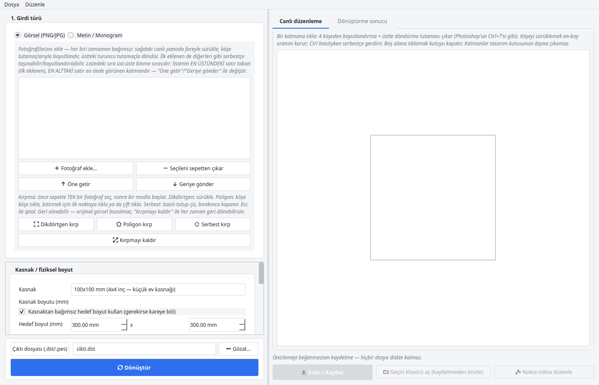
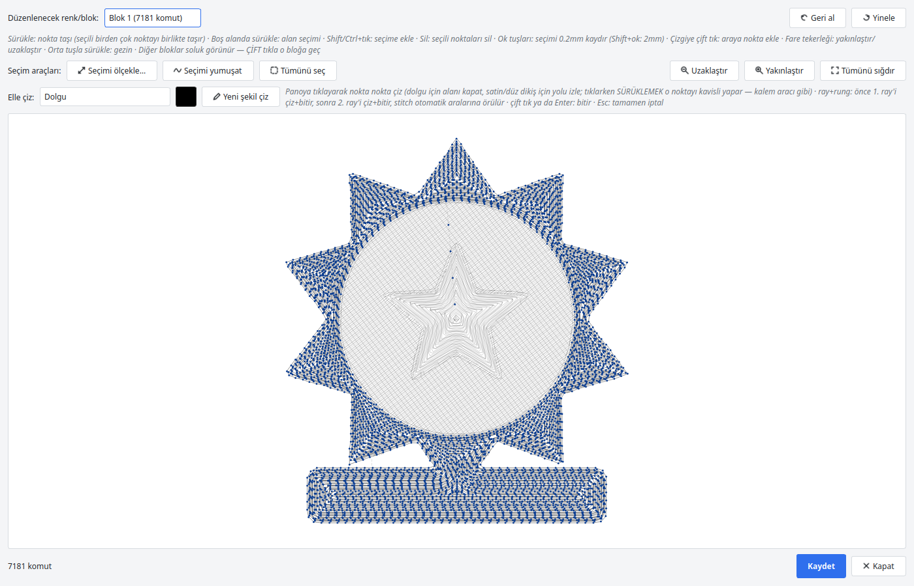
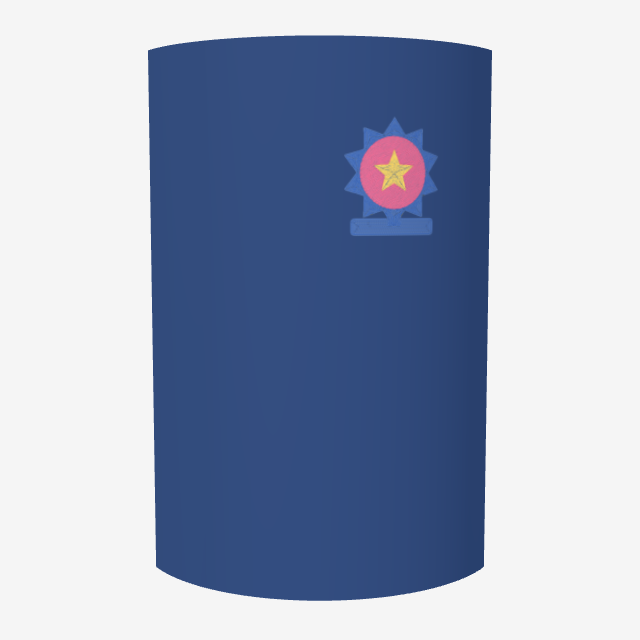
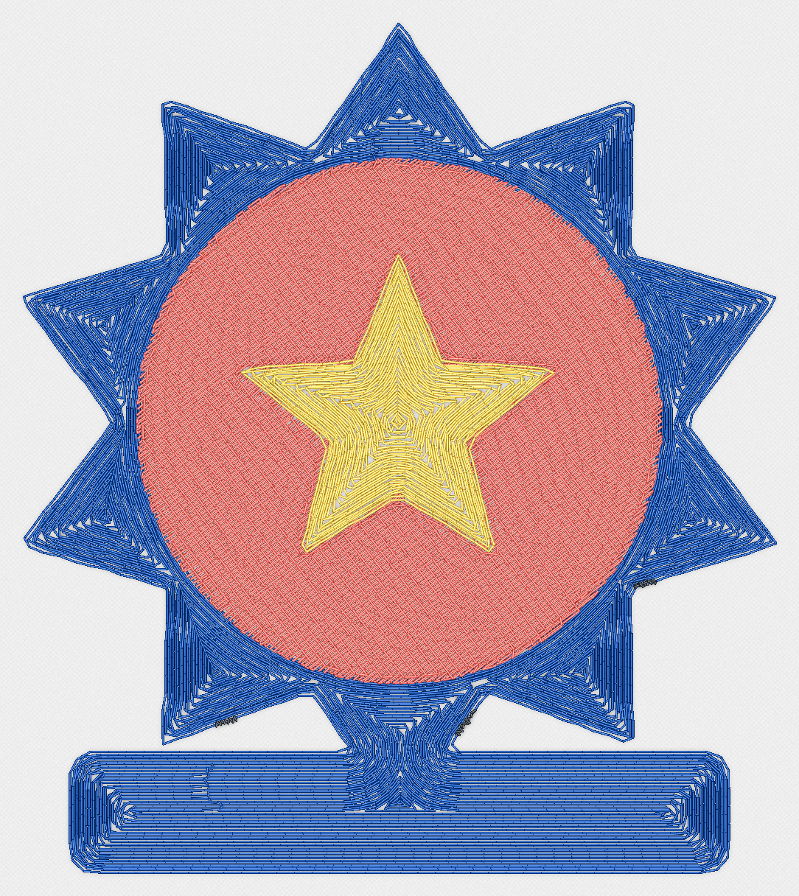
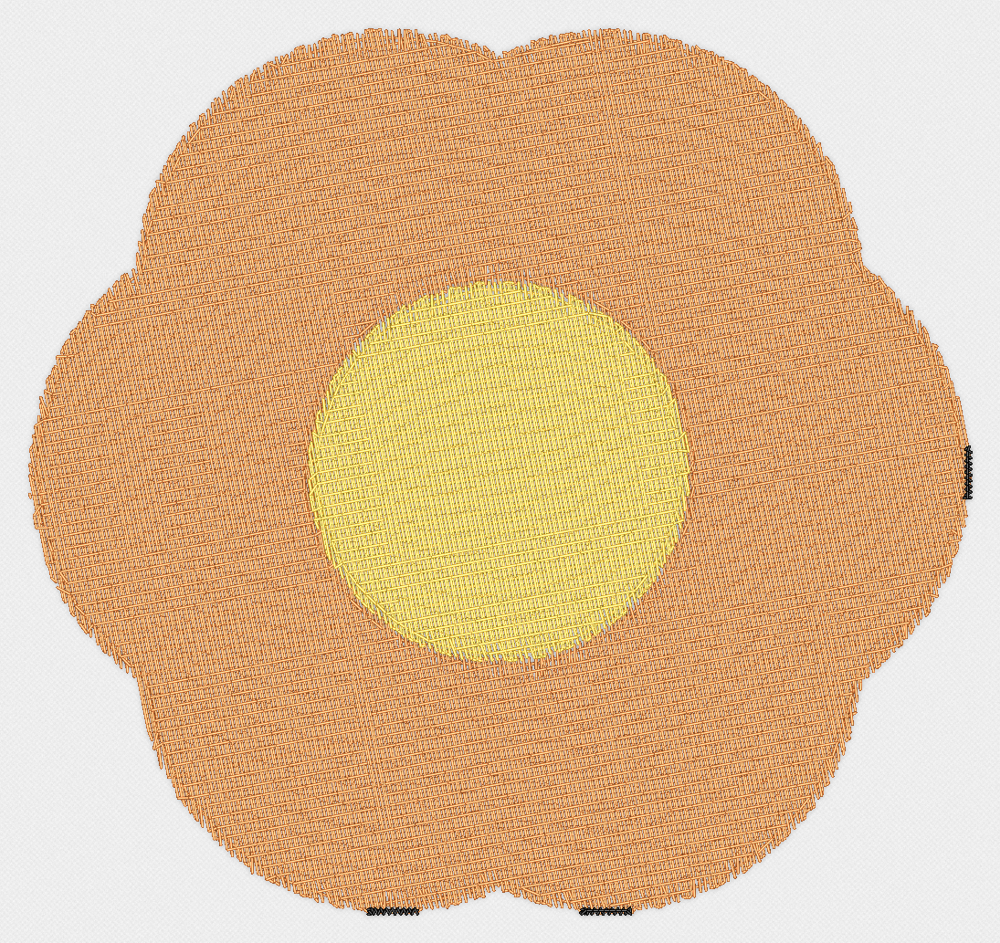
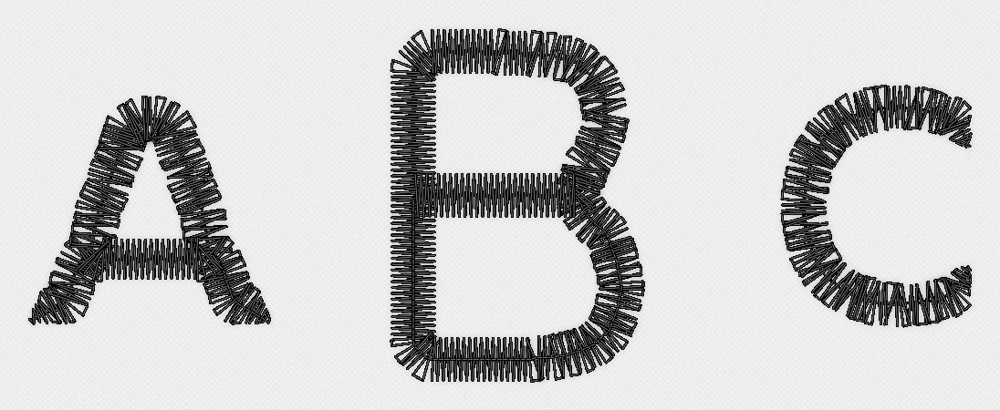

# Embroidery Converter

Bir fotoğrafı ya da yazdığın bir metni, nakış makinenin doğrudan
okuyabileceği bir dikiş dosyasına (`.dst` / `.pes`) çeviren bir masaüstü
programı. Sade ve sakin bir arayüzü var — flaşlı değil, uzun süre
kullanılacak bir araç gibi tasarlandı.

Çevirdiği her tasarımı kafadan atmıyor: dikişi önce fiziksel olarak
simüle edip kaynak görselle karşılaştırıyor, kaç renk/dikiş bütçesine
sığdığına bakıp en yakın sonucu kendisi seçiyor.

## İndir ve çalıştır

Kurulum yok, Python kurmanıza gerek yok — [Releases](../../releases)
sayfasından işletim sisteminize uygun tek dosyayı indirip çalıştırmanız
yeterli.

- **Linux**: `EmbroideryConverter-linux-x86_64` dosyasını indirin,
  `chmod +x EmbroideryConverter-linux-x86_64` deyip çalıştırın.
- **Windows**: `EmbroideryConverter-windows-x86_64.exe` dosyasını indirip
  çift tıklayın.

İlk açılış biraz yavaş olabilir (program kendini geçici bir klasöre
çıkarıyor), sonraki açılışlar hızlanır.

## Neler yapabiliyor

Fotoğraftan ya da logodan başlayıp renkleri otomatik azaltıyor, bölgelere
ayırıyor ve her birine uygun dolgu/satin planını kendisi kuruyor. Düz yazı
ya da klasik üç harfli bir monogram da yazdırabiliyorsunuz — birkaç hazır
fontla birlikte, kendi `.ttf` dosyanızı da kullanabilirsiniz.

Sağdaki panoda tasarımı canlı olarak düzenliyorsunuz: birden fazla görseli
üst üste koyup boyutlandırabilir, döndürebilir, sırasını değiştirebilirsiniz.

Birkaç şey daha:

- Dikdörtgen, poligon ve serbest çizimle kırpma — hepsi geri alınabilir,
  orijinal görsel hiç bozulmaz.
- Tasarımı bir tişört/gömlek kalıbının neresine koyacağınızı gösteren
  görsel bir yerleşim rehberi.
- Son dikişi gerçek bir kumaş yüzeyine sarıp birkaç açıdan gösteren 3D
  önizleme — tasarım gerçekten dikilmeden önce kıyafetin üstünde nasıl
  duracağını görürsünüz.

  

- Üretilen dikişi nokta nokta düzenleyebileceğiniz, elle şekil de
  çizebildiğiniz ayrı bir editör.
- Birden fazla aday ayar deneyip dikiş bütçenize sığan en benzer sonucu
  kendiliğinden bulan bir arama mekanizması.
- Her dönüşümden sonra örtme, yoğunluk, iplik uzunluğu ve tahmini dikiş
  süresini gösteren bir kalite raporu.

## Örnekler

Üç farklı girdiyle ne çıktığına bakın — solda verdiğiniz görsel, sağda
programın ürettiği gerçek dikiş simülasyonu:

| Girdi | Nakış simülasyonu |
|---|---|
|  |  |
|  |  |
| "ABC" monogram (metin girdisi) |  |

Her örneğin ürettiği tüm dosyalar (`.dst`, `.pes`, önizleme, kalite
raporu) `examples/` klasöründe duruyor, isterseniz kendi makinenizde
deneyebilirsiniz.

## Nasıl kullanılır

Programı açtıktan sonra sol üstten görsel ya da metin/monogram girdisini
seçersiniz. Kasnak boyutu, renk sayısı ve kumaş gibi ayarların
varsayılanları çoğu durumda yeterli — dokunmadan da deneyebilirsiniz.
"Dönüştür"e bastığınızda sağ panelde önizlemeyi ve işlem günlüğünü
izlersiniz; sonuç beğenilirse "İndir/Kaydet" ile dosyayı kaydedip,
isterseniz nokta nokta editörle son rötuşları yaparsınız.

## Sorun bildirimi

Bu depo yalnızca programı dağıtmak için — kaynak kodu kapalı. Bir hata
bulduysanız ya da bir özellik önereceğiniz varsa [Issues](../../issues)
sekmesinden yazabilirsiniz.

## Lisans

Programı indirip ücretsiz kullanabilir, dağıtabilirsiniz. Tek yasak:
programın kendisini satmak ya da ticarileştirmek. Onunla ürettiğiniz
şeyleri (nakış dosyaları, diktiğiniz ürünler) satmakta hiçbir engel yok —
tam tersine, zaten amaçlarından biri de bu. Ayrıntılar için
[LICENSE](LICENSE), kullanılan font/veri lisansları için
[THIRD_PARTY_NOTICES.md](THIRD_PARTY_NOTICES.md).
